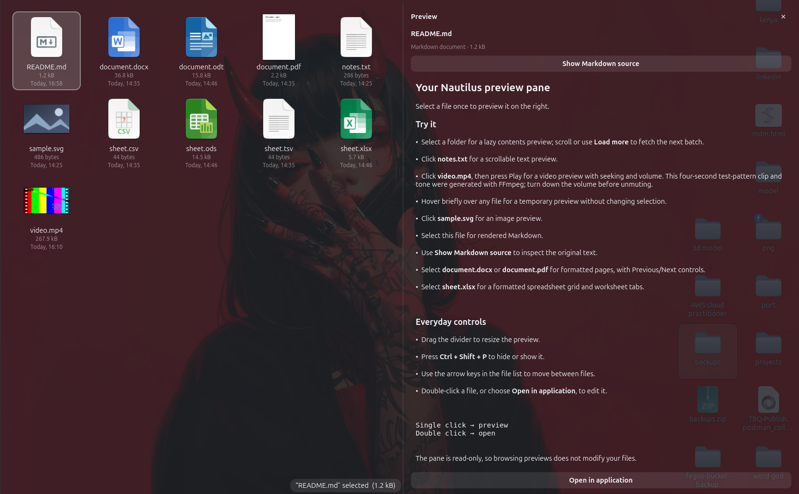
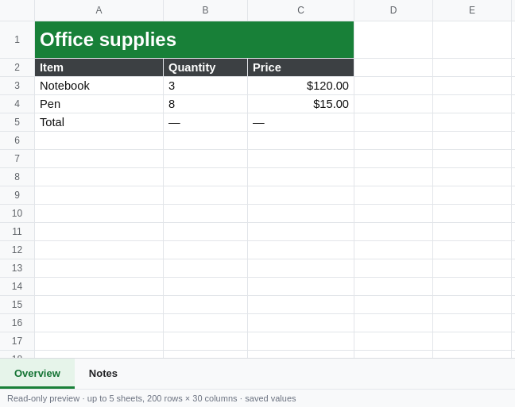
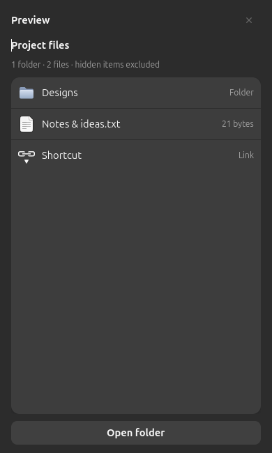
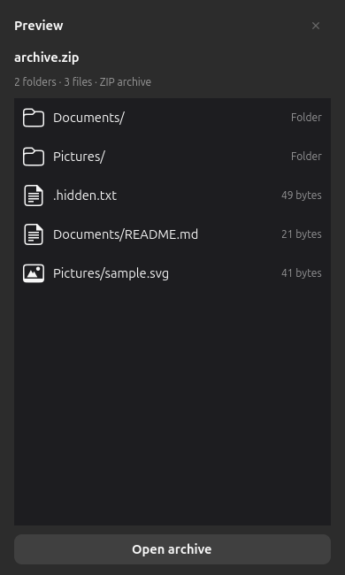
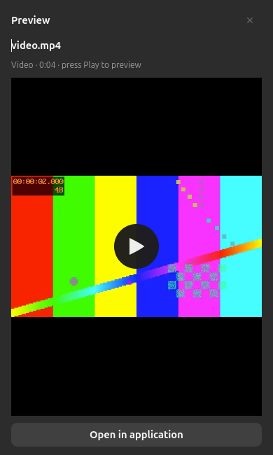
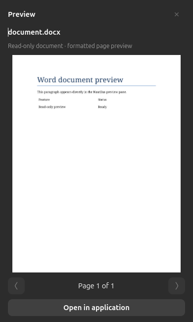

# Smok Glass Nautilus

A Nautilus file manager with a built-in, read-only preview pane. Select a file or folder once to see it on the right: folder contents, ZIP archive listings, videos, formatted document pages, a spreadsheet grid, images, Markdown, and plain text.

Based on **GNOME Nautilus 50.2.2**. This repository contains the complete modified source, local document readers, sample files, and per-user installation tools.



Smoked-glass styling with an embedded Markdown preview.

## See it

### Spreadsheet preview

Column letters, row numbers, worksheet tabs, merged cells, colours, borders, and common number formats—all inside the preview pane.



### Folder preview

Select a folder to see the first 32 files and subfolders immediately, then scroll to fetch more. Rows are recycled as you browse; **Load more** is also available for keyboard access. Each batch puts folders first and sorts names naturally, while previously loaded rows stay in place. **Ctrl+H** also updates hidden items in the preview.



### ZIP preview

Select a local ZIP to see its stored files and folder paths, icons, and uncompressed sizes without extracting it. Entries load in pages of 32 as you scroll, or with **Load more**. Encrypted file entries are labelled when their directory metadata is readable.



### Video preview

Select a local video to preview it with play/pause, seeking, and volume controls. Playback starts paused and stops when you change selection or hide the pane.



### Document preview

Word documents render as pages with their layout preserved. Use the arrows to browse pages.



These are real captures from the native preview widget using the sample files in this repository.

## Features

- Embedded, resizable right preview pane; **Ctrl+Shift+P** toggles it.
- Single-click and arrow-key selection update the preview. Hover over an item briefly for a temporary preview without changing selection; leaving restores the selection preview. Double-click opens the file normally.
- Lazy folder previews: 32 items per batch, automatic loading near the bottom, recycled list rows, and a keyboard-accessible Load more button.
- Folder icons, sizes, hidden-item preference, and empty-folder states.
- ZIP/ZIP64 archive contents with paged entry lists, nested paths, sizes, and encrypted-entry labels; no extraction.
- Rendered Markdown with a source toggle; scrollable, selectable plain text.
- Video playback with native GTK media controls; no autoplay.
- Image previews through GNOME's sandboxed Glycin loaders.
- Formatted PDF, DOCX, ODT, DOC, and RTF pages with Previous/Next controls.
- XLSX, XLS, ODS, CSV, and TSV previews in a read-only spreadsheet grid with worksheet tabs.
- Background loading, rapid-selection debounce, cancellation, and stale-result protection.
- Per-user installation with launcher backups. The distribution's `/usr/bin/nautilus` stays intact.

## Status and requirements

**Experimental desktop software.** Tested locally on **Ubuntu 26.04 / GNOME 50**, GTK 4.22 and libadwaita 1.9. The source requires libarchive ≥3.6, GTK ≥4.20, libadwaita ≥1.8, GLib ≥2.84, Glycin 2, and the other libraries listed in `meson.build`.

Video previews use GTK’s GStreamer backend and installed codecs (`gstreamer1.0-plugins-good` and `gstreamer1.0-libav` on Ubuntu). Format support depends on those codecs.

The `smok-glass` helpers also require Python 3, openpyxl, Poppler, LibreOffice Writer/Calc, Bubblewrap, and WebKitGTK 6. The dependency installer currently targets Ubuntu 26.04; other distributions need equivalent packages and compatible library versions.

## Build and install

Clone this repository, then run:

```bash
git clone https://github.com/sandeepkrishnams/smok-glass-nautilus.git
cd smok-glass-nautilus
./scripts/install-deps.sh
./scripts/build.sh
./scripts/test.sh
./scripts/install.sh
```

The default prefix is `~/.local/opt/smok-glass-nautilus`. Only dependency installation uses administrator access; the build and file-manager launchers install under your own home directory.

After active file transfers finish, close Files, run `nautilus --quit`, and reopen Files. The normal Files launcher will use this build. Open `samples/` to try the previews.

To install the binary without changing your default Files launcher:

```bash
./scripts/install.sh --no-activate
~/.local/bin/smok-glass-nautilus
```

To choose another prefix, set `PREFIX` before building:

```bash
PREFIX="$HOME/.local/opt/my-nautilus" ./scripts/build.sh
./scripts/install.sh
```

Existing system Nautilus extension modules are reused where available. The default build disables compiling upstream stock extensions and cloud-provider integration to keep its dependency set manageable.

## Controls

| Action | Control |
| --- | --- |
| Show/hide preview | **Ctrl+Shift+P**, or View menu → Preview Pane |
| Change preview | Click a file or folder, or use **↑ / ↓** in the file list |
| Temporary preview | Hover over an item for about half a second; move away to restore selection |
| Play/pause, seek, volume | Video controls (move the pointer over the player to reveal them) |
| Resize pane | Drag its divider |
| Browse document pages | Previous/Next buttons beneath the page |
| Browse more folder contents | Scroll toward the bottom, or use **Load more** |
| Change worksheet | Tabs beneath the spreadsheet grid |
| Read Markdown source | **Show Markdown source** |
| Edit/open a file | Double-click it or use **Open in application** |

## Preview limits

- File-content previews support local files only; unsupported and remote files offer the normal Open action. Folder listings also support locations available through GIO, including mounted network folders.
- Folder previews read immediate children in pages of up to 32 visible items, scanning at most 256 entries per request when filtering hidden files. Scrolling fetches the next page; there is no longer a 500-item total limit. A hidden-only batch offers **Load more** to continue without scanning the entire folder automatically.
- Folder counts describe loaded items until the directory ends. Each batch is sorted with folders first; the complete directory is not scanned for a global sort. Symlinks inside a folder are listed without following their targets.
- Videos stream from local files without the image/document size cap; damaged files or missing codecs show an Open fallback. Playback remains paused until you press Play.
- ZIP previews support local `.zip`/`.zipx` files with readable ZIP or ZIP64 directories. The central index is limited to 16 MiB / 100,000 entries; libarchive may index that metadata before returning the first page. Other archive formats and remote ZIP files use the normal Open action.
- Archive rows show stored entry paths across all levels, including hidden entries; implicit parent folders are not synthesized. Listing does not verify passwords, checksums, or member data. Damaged/unsupported directory metadata shows an explanation.
- Text previews stop after 512 KiB. Document and image input files above 100 MiB show a fallback.
- Spreadsheet previews show up to 5 visible sheets, 200 rows and 30 columns per sheet.
- Spreadsheet formulas are not recalculated. Saved results are shown; `—` marks a formula without a saved result. Charts, embedded drawings, conditional formatting, and every Excel number-format variant are not implemented.
- Word/OpenDocument pages use LibreOffice rendering. Available fonts can affect layout compared with Google Docs or Microsoft Office.
- Encrypted, damaged, unusually complex, and timed-out documents show an explanation instead of a preview.

Office conversions run headlessly with networking disabled, a read-only source filesystem, and macros disabled in a private profile. Spreadsheet content is escaped; its viewer disables JavaScript and uses a restrictive content policy. Previews do not edit the original files.

Converted office previews are stored in a private cache under `${XDG_CACHE_HOME:-~/.cache}/smok-glass-nautilus`, keyed by source path, modification time and size. The cache retains at most 32 items / 128 MiB; deleting it clears the previews without affecting original documents.

## Optional glass appearance

The preview feature works with your normal GTK theme. A charcoal glass stylesheet is included in `styles/gtk4.css`.

Back up `~/.config/gtk-4.0/gtk.css`, then add an `@import` pointing to that stylesheet if you want the matching appearance. Real background blur additionally requires a compatible [Blur My Shell](https://github.com/aunetx/blur-my-shell) installation, application blur enabled for `org.gnome.Nautilus`, and suitable transparent surfaces. The project does not automatically install or change GNOME Shell extensions.

## Restore your previous file manager

```bash
./scripts/uninstall.sh
```

This restores backed-up launchers. To remove this project's launcher overrides and explicitly use the distribution's Nautilus instead:

```bash
./scripts/uninstall.sh --stock
```

Restart Files after switching. The installed build is retained so it can be inspected or reactivated; its location is printed by the script.

## Development and tests

```bash
./scripts/test.sh
./scripts/test-native.sh
./scripts/test-native.sh --sheet-only
```

Native widget checks require a graphical session and the helpers installed at the build's prefix. They exercise Markdown, text, images, formatted office pages, PDF navigation, spreadsheet rendering, cancellation, and large-file handling. Captures go into ignored `test-artifacts/`.

See [CONTRIBUTING.md](CONTRIBUTING.md), [SECURITY.md](SECURITY.md), and [docs/ARCHITECTURE.md](docs/ARCHITECTURE.md).

## Upstream and licence

Smok Glass Nautilus is a community modification of [GNOME Nautilus](https://gitlab.gnome.org/GNOME/nautilus), starting from tag `50.2.2`. Original copyright notices and file-level licences are retained. The original project documentation is preserved in [README.upstream.md](README.upstream.md).

The project is distributed under **GPL-3.0-or-later**; see [LICENSE](LICENSE). Some upstream components retain their own compatible file-level licences. Runtime dependencies retain their respective licences and are not vendored here.

This fork does not automatically receive later Nautilus fixes. Maintainers and users should track upstream security updates and rebuild or restore the distribution version when needed.
